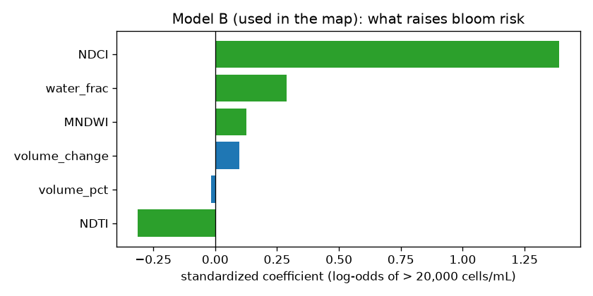

# Alerta Açude
**Track:** Climate
**Team:** *(names, emails and schools to be confirmed)*

> This project is a prototype. It does not replace laboratory testing of drinking water.

**Main takeaway:** on two sets of future campaigns, the colour of the water seen from space (Sentinel-2) was about as good as the last lab result at telling whether a reservoir is above the legal cyanobacteria limit. It is available every few days instead of every three months. But in our region blooms are the norm, and no method we tried is good at spotting the few clean reservoirs.

## The problem

The semi-arid interior of Ceará, Brazil, drinks from **açudes** (reservoirs). Heat and drought concentrate nutrients and warm the water, which feeds **cyanobacteria blooms**, and many cyanobacteria produce toxins. Brazil's drinking-water rule (Portaria GM/MS nº 888/2021, art. 43 § 2º) says that **above 20,000 cyanobacteria cells/mL at the intake, cyanotoxins must be analysed at least weekly**.

The state water agency COGERH samples about 150 reservoirs, but only **once per quarter**. Between campaigns a bloom can grow for three months unseen. In the Jaguaribe system, where Tabuleiro do Norte, Limoeiro do Norte and Russas have depended on the Castanhão reservoir, **78% of the 1,479 lab samples from 2016 to 2025 were above 20,000 cells/mL**.

**User:** a COGERH water-quality technician, or the operator of a Jaguaribe Valley water service.
**Decision:** *which reservoirs do I sample first this week, and where do I start toxin testing before the next lab campaign?*
Today their best guess is the **last lab result**, up to three months old.

## What we built

A weekly risk map (`outputs/risk_map.html`, notebook 05). For each reservoir of the Jaguaribe system it uses:
- the most recent clear **Sentinel-2** image;
- the **weather** of the days before it;
- today's **stored volume**.

It returns:
- the **probability that cyanobacteria exceed 20,000 cells/mL**;
- an **Alert / Lower risk** band from a threshold fixed on validation data;
- a ranked list;
- the **top three reasons in plain language**;
- the last lab result, for comparison.

## What we added

- **Our own ground truth.** We parsed all 28 COGERH trophic-state reports (PDF, Feb/2016 to Feb/2025) into one table of 3,679 lab samples from 156 reservoirs. A parser test reproduces four known values exactly.
  - We cross-checked every value against COGERH's own online database. The two sources agree on 99.6% of counts.
  - We found and documented errors in both sources: a shifted table in one report, and counts stored divided by 1,000 in the database for two campaigns.
  - We drop a sample only when the two sources contradict each other (23 samples).
- **Our own user and question:** a technician deciding where to sample, compared against what they know today (the last lab result).
- **Our own questions:** does it still work in drought (volume < 20%)? On reservoirs it never saw? When the image is within 2 days of the lab visit?
- **A second, pre-registered test.** After the first test exposed a weakness, we wrote down a fix and a decision rule (commit `50b694b`) *before* touching six newer campaigns (May/2025 to Aug/2026) that no model had seen. Then we scored them once.

## How it works

**Data** (all public):
- **Lab results:** COGERH IET reports, checked against the Portal Hidrológico database.
- **Reservoir points and basins:** Portal Hidrológico do Ceará. **Water polygons:** OpenStreetMap.
- **Satellite:** Sentinel-2 L2A (Microsoft Planetary Computer).
  - For each lab sample, we take the closest image within ±5 days.
  - We keep only pixels the scene classification calls water **and** with MNDWI > 0, eroded 2 pixels from the shore, within 1 km of the sampling point.
  - We correct the 2022 change in processing baseline (−1000 offset).
- **Weather:** NASA POWER daily. **Stored volume:** COGERH.

For bandwidth we extracted satellite data only for the **Jaguaribe system** (65 reservoirs, 1,479 usable lab samples). **614 samples have a clear image**:
- 730 were too cloudy;
- 135 had no image within 5 days, mostly in 2016–2017, when only one Sentinel-2 satellite was flying.

The chlorophyll index NDCI follows lab chlorophyll-a closely (Spearman 0.81), and cyanobacteria counts less so (0.41).

**Features (15):**
- **Satellite:** NDCI (chlorophyll), NDTI (turbidity), MNDWI, share of the area that is water.
- **Weather:** max temperature (7 and 30 days), rain (30 and 90 days), wind, sunlight.
- **Water:** volume % and its change since the last campaign.
- **Season:** month and rainy season.

There is no location or reservoir ID, so the model cannot memorise reservoirs.

**Model:** logistic regression on standardized features. Its coefficients are the explanation. On validation it beat a small LightGBM (PR-AUC 0.951 vs 0.928), so we kept the simpler model. After Test 1, a pre-registered rule replaced it in the map with an even simpler version that uses only the 6 satellite and stored-water inputs (see Test 2). Explanations add related inputs together (both temperature windows, both rain windows, month + season), because they are strongly correlated (0.91 for temperature) and would otherwise give contradictory reasons.

*Model B, used in the map: each bar is how much one standard deviation of an input changes the log-odds of a bloom. NDCI dominates (+1.39); more open water near the sampling point (+0.29) and lower turbidity (NDTI −0.31) also raise the risk. Lower turbidity raising the risk is consistent with the colour coming from algae rather than from sediment; that is our interpretation, not something we tested. The map's reasons say whether each value is above or below the training average ("greener than usual", "less turbid than usual"); the arrow says whether it raised or lowered the risk. The SHAP summary in `outputs/lgbm_shap_summary.png` is for the small LightGBM, for comparison only (not used in the map).*

**Testing:** time split by campaign, never shuffled.

| Split | Campaigns | Dates | Samples | Share above 20,000 |
|---|---|---|---|---|
| Train | 16 (May/2016 to Feb/2020) | 2016-05-09 to 2020-02-12 | 288 | 74% |
| Validation | 5 (Aug/2020 to Aug/2021) | 2020-07-28 to 2021-09-14 | 142 | 92% |
| Test 1 | 6 (Nov/2021 to Feb/2025) | 2021-10-05 to 2025-03-12 | 184 | 87% |
| Test 2 (database only) | 6 (May/2025 to Aug/2026) | 2025-04-03 to 2026-08-25 | 238 | 89% |

The decision threshold is chosen on validation to catch at least 80% of blooms, because a missed bloom is worse than an extra sample.

## Results

**Test 1** (184 samples, 160 above 20,000 cells/mL; every method scored on the same samples):

| Method | Recall | Precision | Missed blooms | False alarms | PR-AUC | PR-AUC for *clean* water | Balanced accuracy¹ |
|---|---|---|---|---|---|---|---|
| Persistence (last lab result) | 0.90 | 0.89 | 16 | 18 | 0.931 | 0.281 | 0.575 |
| Always "bloom" | 1.00 | 0.87 | 0 | 24 | 0.870 | 0.130 | 0.500 |
| NDCI > t (one satellite index) | 0.99 | 0.89 | 1 | 19 | 0.962 | 0.455 | 0.601 |
| **Logistic regression (chosen)** | 0.89 | 0.89 | 17 | 18 | 0.944 | 0.225 | 0.572 |
| LightGBM (small) | 0.88 | 0.93 | 19 | 11 | 0.943 | 0.425 | 0.711 |
| Logistic regression + last lab result | 0.88 | 0.89 | 20 | 18 | 0.952 | 0.268 | 0.562 |

¹ Balanced accuracy is a secondary metric, not pre-registered; the pre-registered metric is PR-AUC.

- **Combining the satellite with the last lab result did not reduce missed blooms** (20, vs 17 for the satellite model and 16 for persistence).
- **The model ties persistence; it does not beat it.** The bootstrap 95% interval for the PR-AUC difference (model − persistence) is −0.030 to +0.056. The satellite gives the technician about what a three-month-old lab result gives, with no lab visit.
- **The PR-AUC values above 0.95 are not leakage.** 87% of test samples are blooms, so a random guess already scores 0.87. A model trained on shuffled labels scores 0.868, and no lab value is among the inputs.
- **The hard part is finding the clean reservoirs** (last column; chance = 0.13). The single index NDCI does best (0.455). Our chosen model is worse than persistence here.

**Our own questions** (Test 1):
1. **Drought (volume < 20%):** no drop. Recall 0.89 and precision 0.91 (38 samples), vs 0.90 and 0.88 above 20% volume.
2. **Unseen reservoirs** (5 folds grouped by reservoir, all years): the model and persistence tie, with mean PR-AUC 0.913 each.
3. **Image within 2 days of the lab visit:** no gain. PR-AUC 0.937 on 130 samples, vs 0.944 for all.

**Where it fails, and why** (thumbnails in `outputs/failures_rgb.png`, checks in notebook 04):
- **Missed blooms come from the season inputs, not from clouds.** The five worst misses were all in the Oct–Dec 2021 campaign, and their thumbnails showed broken clouds. But across the whole test set, partly cloudy scenes had *fewer* errors (14%) than clear ones (24%). What the misses share is the season: 16 of the 17 missed blooms were in the dry-season campaigns (Aug, Nov). In 2016–2020, dry-season samples were blooms less often (70% vs 79%), and the model learned that through its season and temperature inputs. In the test years, dry-season blooms were common (84%). Model A's coefficients (`outputs/lr_coefficients_modelA.png`) show this: `month_sin` is +0.73, and the two temperature windows have opposite signs (`tmax_7d` −0.73, `tmax_30d` +0.37) although they are 0.91 correlated. That is why the map's explanations add related inputs together, and why model B drops the season and weather inputs.
- **Many cells, little chlorophyll.** For example, Riacho do Sangue had 191,134 cells/mL but only 12.85 µg/L chlorophyll-a. NDCI sees chlorophyll, not cell numbers.
- **False alarms:**
  - Atalho (16,046 cells/mL) and Bengue (10,422) were close to the limit; both are above 10,000, where the same Portaria (Annex 12) already asks for weekly cyanobacteria counts.
  - Poço da Pedra was green from other algae: 13.90 µg/L chlorophyll-a but only 4,130 cyanobacteria cells/mL.
  - Cachoeira's image was hazy.
- **The water-share input partly measures geometry, not water.** `water_frac` (share of the area near the sampling point that is water) raises the risk, but it also depends on the sampling area's shape and the reservoir's size. It is tiny when the area fell back to a plain disc or the reservoir is nearly dry, which pushes those reservoirs toward "Lower risk" for reasons unrelated to water quality. On the live map, 6 of the 49 imaged reservoirs are flagged **low confidence** (disc fallback, water share < 5%, or volume < 5%). São José II (1% water) and Santo Antônio (2%) are "Lower risk" although their last lab counts were 206,178 and 69,021 cells/mL; Cedro (0.44% volume) and Pirabibu (0.63%) are nearly empty. The flag only changes the display (dashed outline, a popup note), not the risk or the band.

**Test 2 (pre-registered, six campaigns nobody had seen):**

We wrote down a hypothesis and a rule before extracting anything (commit `50b694b`). The hypothesis: a model without the season and weather inputs ("B": satellite + stored water, 6 inputs) misses fewer dry-season blooms than the chosen model ("A"). The rule: the map uses B if its PR-AUC is within 0.02 of A's. The test covers 238 samples (89% blooms), with counts from COGERH's database only, because no PDF report exists for these campaigns yet. A filter for the database's thousands-separator slip (counts below 1,000 with decimals) could have removed genuine clean samples; in these six campaigns it dropped **0 rows** in any basin (`data/processed/new_campaign_slip_dropped.csv`), so it cannot have biased Test 2.

| Method | Recall | Precision | Missed blooms | False alarms | PR-AUC | PR-AUC for *clean* water | Balanced accuracy¹ |
|---|---|---|---|---|---|---|---|
| Persistence (last lab result) | 0.93 | 0.94 | 16 | 13 | 0.975 | 0.435 | 0.702 |
| NDCI > t | 0.93 | 0.92 | 15 | 17 | 0.980 | 0.371 | 0.625 |
| A: logistic regression, 15 inputs | 0.83 | 0.94 | 37 | 11 | 0.958 | 0.269 | 0.693 |
| **B: satellite + stored water, 6 inputs** | 0.86 | 0.95 | 29 | 10 | 0.972 | 0.380 | 0.732 |

¹ Not pre-registered (the pre-registered metric was PR-AUC). On it, model B is highest: 0.732, vs persistence 0.702 and NDCI 0.625.

- **The hypothesis held.** In the dry-season campaigns, B missed 22 blooms and A missed 30. B also scored higher overall, so **the map uses B**.
- **The last lab result is still not beaten.** The bootstrap 95% intervals for the difference with persistence include zero:
  - B: −0.026 to +0.020;
  - NDCI: −0.012 to +0.025.

  In the dry season, persistence missed only 10 blooms.

**Why not just use NDCI?** In both tests the single-index rule NDCI > t has the highest PR-AUC (Test 1: 0.962; Test 2: 0.980). The chlorophyll seen from space is the core signal: one index alone already ties the last lab result. The model adds stored volume, a calibrated probability, a ranking and plain-language reasons, and raises fewer false alarms (Test 2: B 10 vs NDCI 17), at the cost of more missed blooms (29 vs 15). In Test 1 the NDCI rule missed fewer blooms than the model (1 vs 17) with about the same false alarms (19 vs 18).

**Live map (14 Nov 2026, model B, `outputs/risk_map.html`):**
- 49 of the 65 Jaguaribe-system reservoirs had a clear image between 24 Oct and 13 Nov; 16 had none.
- **38 are on Alert and 11 are Lower risk.** Castanhão is on Alert, at 0.50.
- Several "Lower risk" reservoirs had counts well above 20,000 at their last lab visit (Aug 2026). So the band means "can wait if capacity is short", not "safe", and the map says this is the season where the model under-warns.
- NASA POWER sunlight was not yet published for the last days, but model B does not use weather.

## What we'd do next

- Retrain on all campaigns up to Aug/2026 (we kept the newest ones for testing), and keep re-checking each new campaign as COGERH publishes it.
- Extract the other basins of Ceará (≈ 2,000 more lab samples), which our connection did not allow in 48 hours.
- Replace `water_frac` with a geometry-independent feature (for example, water area relative to the reservoir's full-capacity outline).
- Add red-edge bands B06/B07 for a three-band chlorophyll index, and a phycocyanin proxy to separate cyanobacteria from other algae.
- Ask COGERH technicians whether a ranked list helps them plan sampling, and which mistakes cost them more.
- The same pipeline needs only Sentinel-2, NASA POWER and a lab table, so it could run on semi-arid reservoirs elsewhere (Northeast Brazil, Spain, the Sahel, Australia). We have not tested that.

## Sources

**Data**
- COGERH / FUNCEME, *Relatórios de Estado Trófico (IET)*, 28 campaigns Feb/2016 to Feb/2025, Portal Hidrológico do Ceará: https://www.hidro.ce.gov.br/documentos/152 (file list and URLs in `data/raw/cogerh/SOURCES.md`).
- Portal Hidrológico do Ceará: eutrophication database (`/acude/eutrofizacao`, `/acude/eutrofizacao/dadosanuais`) and daily reservoir levels (`/quantidade-nivel-diario`), https://www.hidro.ce.gov.br (details in `data/raw/hidro/SOURCES.md`).
- Copernicus Sentinel-2 Level-2A data (ESA), accessed through Microsoft Planetary Computer: https://planetarycomputer.microsoft.com/dataset/sentinel-2-l2a
- NASA POWER daily data (MERRA-2 based), NASA Langley Research Center: https://power.larc.nasa.gov
- Map data © OpenStreetMap contributors, ODbL (via the Overpass API): https://www.openstreetmap.org/copyright

**Law and context**
- Brasil, Ministério da Saúde. Portaria GM/MS nº 888, de 4 de maio de 2021 (art. 43; Anexo 12): https://bvsms.saude.gov.br/bvs/saudelegis/gm/2021/prt0888_07_05_2021.html
- Diário do Nordeste, "Castanhão tem o segundo pior volume para setembro da história", 9 Sep 2019: https://diariodonordeste.verdesmares.com.br/regiao/castanhao-tem-o-segundo-pior-volume-para-setembro-da-historia-1.2147535

**Methods**
- Mishra, S. & Mishra, D. R. (2012). Normalized difference chlorophyll index: A novel model for remote estimation of chlorophyll-a concentration in turbid productive waters. *Remote Sensing of Environment*, 117, 394–406.
- Xu, H. (2006). Modification of normalised difference water index (NDWI) to enhance open water features in remotely sensed imagery. *International Journal of Remote Sensing*, 27(14), 3025–3033.
- Lacaux, J. P. et al. (2007). Classification of ponds from high-spatial resolution remote sensing: Application to Rift Valley Fever epidemics in Senegal. *Remote Sensing of Environment*, 106(1), 66–74. (NDTI)

**Software:** Python, pdfplumber, pandas, NumPy, SciPy, GeoPandas, Shapely, pystac-client, planetary-computer, odc-stac, rasterio, scikit-learn, LightGBM, SHAP, Matplotlib, Folium, Jupyter (versions in `requirements.txt`).

**AI tools:** Claude Code (Anthropic), running Claude Opus 5.5, was used as a coding assistant for the parser, the data pipeline, the notebooks and drafting this write-up. Every result was produced by the code in this repository.
